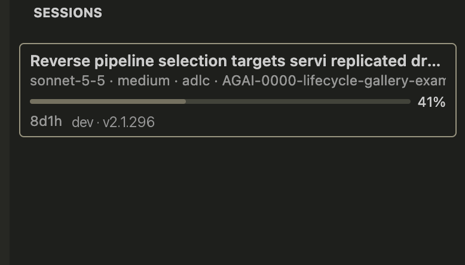
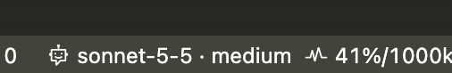

# Claude Context for VS Code

The VS Code counterpart of [`iterm-claude-statusbar`](../iterm-claude-statusbar): an Activity Bar sidebar and a status bar item showing the Claude Code sessions in this window.

Per session: model and effort, directory, git state, context usage against the window size (with a warning color at 70% and 90%), session age, running subagents, AWS profile and Claude version.

Like the iTerm plugin it reads only the local files Claude already writes (`~/.claude/sessions`, the transcripts under `~/.claude/projects`, `settings.json`), so it needs no hooks or status line, and it does not touch or fork the Claude extension. Nothing leaves your machine.

## Install

You need Node.js (for `npm`) and VS Code and/or Cursor. From the root of this repo:

```bash
vscode-claude-context/install.sh            # VS Code and Cursor, whichever are installed
vscode-claude-context/install.sh --cursor   # Cursor only
vscode-claude-context/install.sh --code     # VS Code only
vscode-claude-context/install.sh --build-only
```

The script runs the tests, builds `claude-context-<version>.vsix` and installs it. Then **reload each editor window**: `Cmd+Shift+P` > `Developer: Reload Window`. The Claude Context icon appears in the Activity Bar (click it to open the sidebar), and a status bar item shows the focused session.

If the script cannot find an editor, run `Extensions: Install from VSIX...` in the editor and pick the `.vsix` it printed. `code` must be on your PATH for VS Code (`Cmd+Shift+P` > `Shell Command: Install 'code' command in PATH`). Re-run the script any time to update; it replaces the installed version.

Supported on macOS (and likely Linux); session discovery shells out to `ps`, so Windows is not supported.

## What you see





- **Sidebar** with one card per Claude session in this window: the tab name, model and effort, directory and git state, a context bar with the percentage (hover for exact tokens), session age, subagents, AWS profile and Claude version.
- **The card for the tab you are looking at** is highlighted and carries a `THIS TAB` badge, and moves to the top. Switch tabs and the highlight follows.
- **Status bar item** with the model, effort and context usage of that same session.

## How sessions are matched

iTerm binds a status bar to a pane's TTY; the Claude extension has no TTY. Instead a session is shown when it is a live `claude-vscode` session whose working directory is inside one of this window's workspace folders. The card is tied to its tab by the tab name, which is the session title (your `/rename`, else Claude's auto title). A tab that is open but has not started a Claude process yet has no card until you send a message in it.

## Settings

| Setting | Default | Meaning |
|---|---|---|
| `claudeContext.showAllWorkspaces` | `false` | List sessions from every VS Code window |
| `claudeContext.includeTerminalSessions` | `false` | Also list `claude` CLI sessions started in a terminal |
| `claudeContext.refreshSeconds` | `3` | Refresh interval |

## Not covered

Cost, lines changed and rate limits, which Claude only passes to a status line script (same gap as the iTerm plugin).

## Develop

`npm test` runs the reader tests. To try changes, open this folder in VS Code and press F5.
